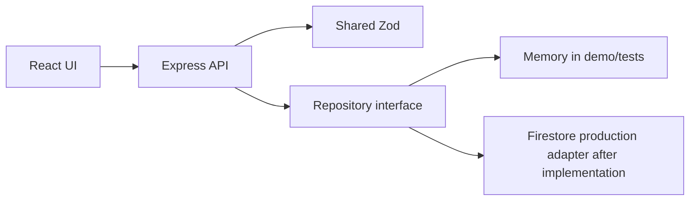

# Architecture

Trust boundary is the Express API. Client role checks are only hints. All object-level authorization belongs in server business logic. Production Firestore binding is a required project task; not included in the starter.
