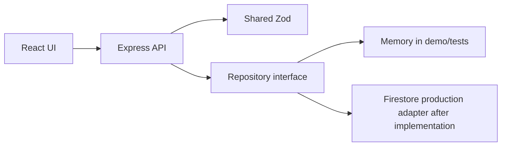

# Architecture

Trust boundary is the Express API. Client role checks are only hints. All object-level authorization belongs in server business logic. Production Firestore binding is a required project task; not included in the starter.

## Implemented storage and access guarantees

The runtime uses Node 26 SQLite, not a Firestore adapter. Sessions are persisted as secret-keyed token digests with fixed expiry; account state is rechecked on every authenticated request. API errors expose a correlation ID rather than exception messages. Origin checks use exact allowlists and state changes require session-bound CSRF tokens. SQL pagination applies scope before LIMIT/OFFSET and batches attachment metadata. Database triggers reject audit updates/deletes. SQL migrations are copied by the build and Docker packaging.

AI responses are untrusted: structured output is validated with Zod and quoted requirements must match actual source text. Missing credentials or invalid provider responses produce an explicitly manual proposal. Reviewers and administrators must confirm uncertainties before publication. Generated presentation applications use real repository transactions and valid sample evidence; they are labelled fictional. Due reminders are generated idempotently when the student loads notifications, not by a background email scheduler.
